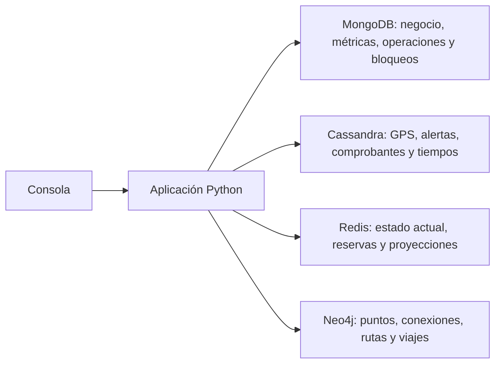
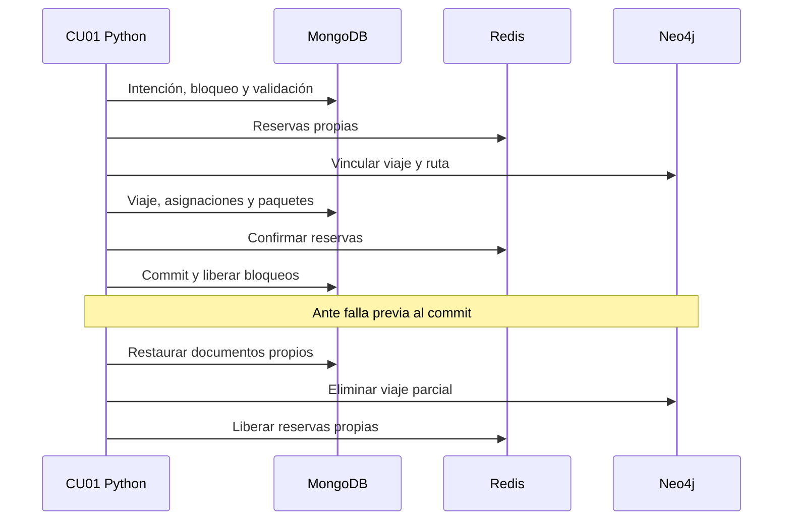
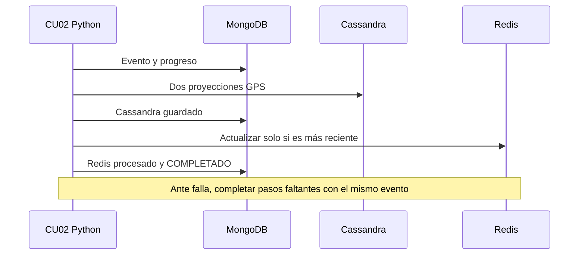
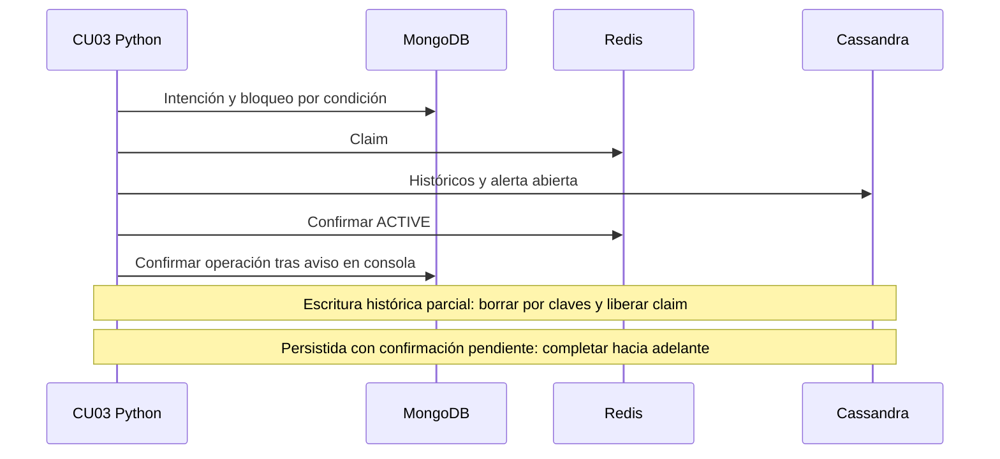
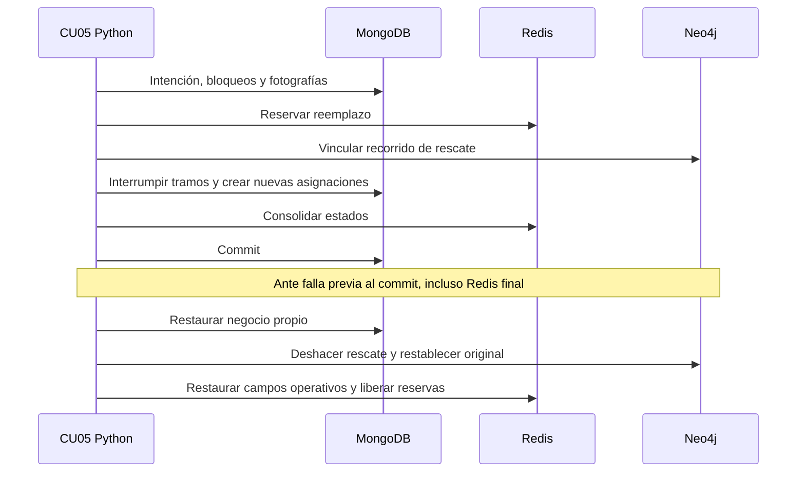
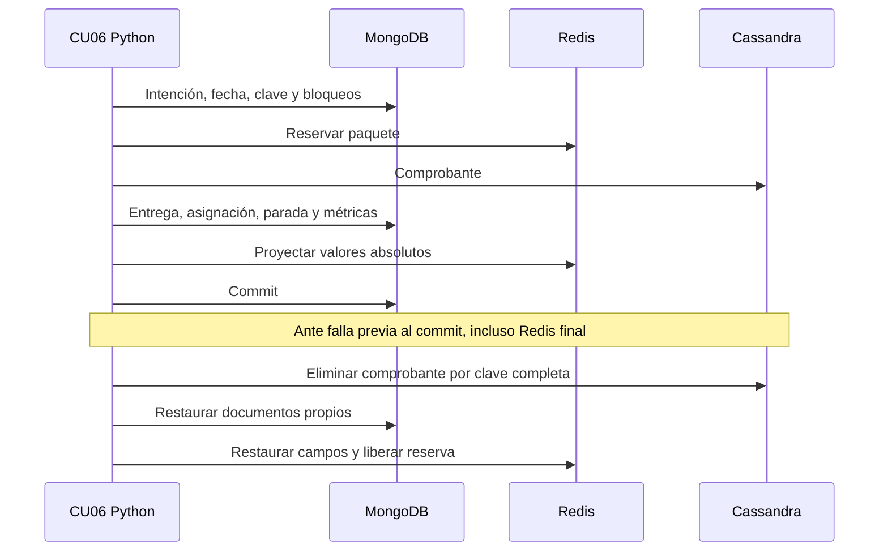

# Sistema de logística y tracking de flota

Informe técnico de la Etapa 2. Ingeniería de Datos II, Grupo 3.
Versión correspondiente a la rama `codex/correcciones-consistencia-tpo`.

## 1 Resumen de la arquitectura

La consola Python (`app/main.py`) coordina ocho casos de uso sobre cuatro motores. MongoDB conserva el negocio, los horarios, las métricas y el progreso durable de las sagas; Cassandra organiza los históricos por consultas; Redis mantiene estado actual y reservas; Neo4j representa conexiones y recorridos.



Docker Compose define MongoDB 7.0, Cassandra 4.1, Redis 7.2 y Neo4j 5.26. Se ejecuta Python desde el equipo anfitrión. Es un laboratorio de una instancia por motor, con replicación Cassandra 1; no se implementa alta disponibilidad ni una transacción global.

El código de seguimiento conecta paquete y asignaciones. `viaje_id` conecta negocio, red e históricos; también se comparten patente, conductor, `id_evento` y `alerta_id`. Las escrituras operativas reciben una clave estable de solicitud y conservan sus identificadores en la bitácora.

## 2 Evolución del DER

Se mantienen las 13 entidades del DER actualizado y se adoptan las cinco recomendaciones del modelo inicial:

- **Viaje:** agrupa ruta, vehículo, conductor y fechas; Asignacion conserva los tramos de cada paquete sin repetir la planificación.
- **GPS y alertas vinculados al viaje:** evita inferir la pertenencia exclusivamente por ventanas temporales. CU08 recorta los eventos al período efectivo de cada asignación.
- **Horarios por parada:** ViajeParada se representa como paradas embebidas en el viaje. CU01 guarda horarios explícitos o un plan uniforme de referencia dentro del intervalo previsto.
- **Identificadores internos y Contacto:** se admiten personas y empresas, con unicidad de DNI/CUIT según tipo. Usuario y Conductor tienen identidad interna; username y licencia conservan unicidad.
- **Responsable de planificación/asignación:** los flujos nuevos guardan identificadores de usuarios existentes; CU05 hereda el coordinador del viaje cuando no se indica otro.

Se conserva el orden de RutaPuntoDeEntrega y ViajeParada y la clave de deduplicación de Alerta. No se modificó el dibujo del DER para estas correcciones. La bitácora y los bloqueos son mecanismos técnicos de coordinación.

La desnormalización es explícita: CU02 mantiene las proyecciones GPS por vehículo/día y viaje/día y la última posición Redis; CU03 mantiene históricos y alertas abiertas Cassandra más la representación activa Redis; CU06 mantiene estado comercial MongoDB, comprobante Cassandra y métricas Redis. CU01/CU05 mantienen los vínculos de viaje en el grafo. No existe sincronización de cambios manuales fuera de esos flujos.

La colección MongoDB `alertas` se conserva por compatibilidad con el seed, pero no es un espejo actualizado de CU03: la fuente de sus alertas operativas es Cassandra.

## 3 Matriz entidad o proceso por motor

Volúmenes del seed determinístico; las frecuencias expresan el patrón de uso, no un benchmark.

| Entidad o proceso | Lecturas y escrituras | Volumen | Frecuencia y consistencia | Motor |
|---|---|---:|---|---|
| Contactos, usuarios, conductores y vehículos | Búsqueda por ID y disponibilidad; cambios de estado | 151, 1, 100 y 100 | Por operación; unicidad y control de disponibilidad | MongoDB |
| Paquetes y asignaciones | Consulta por código/viaje; asignar, interrumpir y completar | 2.020 y 2.000 | Por planificación, avería o entrega; una asignación ACTIVA por paquete | MongoDB |
| Viajes, rutas y puntos | Consulta por ID; escritura de recorrido operativo y horarios | 500, 25 y 50 | Por operación; referencias y exclusión controladas por aplicación | MongoDB |
| Telemetría | Insert/upsert por evento; consulta por viaje/vehículo y día | 50.000 mediciones; 50.000 filas por proyección | Cada pocos segundos; claves estables y recuperación de pasos faltantes | Cassandra |
| Progreso GPS | Payload e indicadores de cada motor | Una entrada por evento recibido | Por paso; recuperación hacia adelante | MongoDB, base logistica |
| Alertas | Históricos por día, abiertas y bitácora; activar/resolver condición | 500 por proyección del seed | Según anomalías; identidad durable y reconciliación | Cassandra y Redis; intención técnica en MongoDB |
| Comprobantes y tiempos | Registrar/compensar comprobante; consultar duraciones | 1.950 comprobantes y 1.350 tiempos por tabla del seed | Por entrega y consulta ETA; compensación entre motores | Cassandra |
| Red logística | Recorridos, alternativas y relaciones de viaje | 575 nodos y 850 relaciones | Lecturas CU01/04/07/08 y escrituras CU01/05 | Neo4j |
| Estado, reservas y progreso | Hashes, reservas y actualización temporal | 2.720 claves iniciales | Lectura inmediata; atomicidad local, sin retroceder GPS | Redis |
| Operaciones y bloqueos | Intención previa, pasos, fotografías y exclusión por recurso | Según operaciones ejecutadas | Antes de cada efecto; bloqueo durable hasta commit o compensación | MongoDB |

## 4 Justificación por motor

**MongoDB** conserva documentos comerciales, paradas embebidas e información del receptor, con índices únicos para identidad y asignaciones activas. Cassandra exigiría otras proyecciones para los cambios y búsquedas de negocio; Redis no es la autoridad durable de esas operaciones; el grafo no aporta ventajas para el detalle del paquete. No hay una transacción MongoDB que abarque todos los documentos y motores: la aplicación registra y compensa sus pasos.

**Cassandra** responde al histórico temporal por viaje/vehículo y día. La duplicación evita filtrar todo el conjunto para trazabilidad. MongoDB requeriría otro diseño de índices; Neo4j no necesita representar cada lectura GPS como nodo; Redis no se usa para conservar todo el histórico. No se afirma una ventaja de rendimiento medida frente a esas alternativas.

**Redis** tiene un rol operativo propio: reservas, actualización monotónica de posición y proyecciones inmediatas. Las reservas Lua se liberan por propietario; las sagas además usan bloqueos durables MongoDB para no perder exclusión al desaparecer Redis. Cassandra y Neo4j no sustituyen directamente esos scripts sobre claves; MongoDB conserva la coordinación durable, pero no reemplaza la consulta inmediata implementada.

**Neo4j** expresa conectividad, orden y viajes asociados mediante relaciones. CU07 consulta caminos habilitados que eviten un punto bloqueado. En MongoDB/Cassandra la navegación exigiría otro diseño o recorridos en Python. `shortestPath` minimiza cantidad de saltos; suma distancia y tiempo del camino obtenido, sin optimizarlos como pesos.

Se utilizan los cuatro NoSQL propuestos. No se agrega un relacional adicional porque los procesos implementados se distribuyen entre esos cuatro roles.

## 5 Resolución de los problemas

| Caso | Motores y secuencia | Entrada en código |
|---|---|---|
| CU01 Planificación | MongoDB registra intención, bloquea y valida intervalos/paquetes; Neo4j aporta recorrido; Redis reserva; Neo4j vincula; MongoDB escribe viaje/asignaciones; Redis confirma; MongoDB registra commit. `viaje_id` y solicitud estable. | `app/coordinador_viajes.py:planificar_viaje` y `app/flujos_durables.py:planificar` |
| CU02 Ingesta | MongoDB registra evento; Cassandra conserva proyecciones; Redis actualiza si el instante es posterior; MongoDB confirma progreso. `id_evento`, patente y viaje opcional. Simulación de 50 vehículos. | `app/telemetria.py:registrar_telemetria` |
| CU03 Anomalías | Consulta GPS Cassandra por ventana temporal y agenda MongoDB; registra intención/bloquea; Redis reclama; Cassandra persiste; Redis activa; consola emite. Una lectura normal cierra la condición. `alerta_id`, evento, patente/tipo y viaje. | `app/anomalias.py:procesar_anomalias_telemetria` |
| CU04 ETA | MongoDB aporta horarios/progreso; Redis posición/velocidad; Neo4j tramo; Cassandra tiempos. Calcula duración restante y llegada/demora prevista. Usa `viaje_id` y `tramo_id`. | `app/eta.py:calcular_eta_y_desvio` |
| CU05 Avería | MongoDB registra y bloquea; Redis reserva; Neo4j crea recorrido de rescate; MongoDB conserva historia y transfiere pendientes; Redis consolida; MongoDB confirma. Conecta viaje original/rescate y asignaciones de origen. | `app/reasignacion.py:reasignar_por_averia` y `app/flujos_durables.py:reasignar` |
| CU06 Entrega | MongoDB registra intención; Redis reserva; Cassandra guarda comprobante; MongoDB entrega/cierra parada y recalcula métricas; Redis proyecta; MongoDB confirma. Paquete, viaje y solicitud estable. | `app/entrega.py:confirmar_entrega_paquete` y `app/flujos_durables.py:entregar` |
| CU07 Alternativas | Neo4j determina rutas y viajes afectados y camino alternativo; Redis enriquece con posición actual. No persiste el bloqueo. Identificadores de puntos, rutas y viajes. | `app/rutas_alternativas.py:consultar_impacto_y_alternativa` |
| CU08 Reclamo | MongoDB obtiene paquete/tramos/conductores/vehículos; Cassandra consulta días y filtra períodos; Neo4j agrega el recorrido. Rechaza operaciones pendientes y cambios detectados durante la lectura. | `app/trazabilidad.py:consultar_trazabilidad_completa` |

CU04 combina con peso 50/50 el tiempo restante histórico/planificado y el calculado a velocidad actual. Detenido, conserva el histórico/plan; sin historia, prioriza horarios de las paradas y usa el tiempo del grafo como respaldo. El desvío se mide al segmento disponible, sin cartografía vial externa. Rechaza posiciones de más de 300 segundos por defecto.

CU03 reconoce una parada prevista a menos de 200 metros del punto y dentro de +/-15 minutos del horario, configurable. Consulta umbral + 2 minutos de GPS, incluyendo varios días y todas sus páginas; no limita el análisis a 15 muestras.

## 6 Consistencia y rollback

No hay transacción distribuida. `app/operaciones.py` registra intención antes de efectos, pasos iniciados/completados, fotografías y claves estables. Se compensa también una escritura cuyo ACK se perdió. Un commit durable es terminal: perder su ACK o fallar al limpiar bloqueos no permite revertirlo posteriormente.











Cada paso tiene compensación repetible: reemplazar/restaurar documentos marcados por operación, borrar el comprobante o viaje generado por identidad estable y liberar solo reservas propias. Redis no se restaura borrando GPS posterior: se revierten únicamente campos operativos modificados por la saga.

Los bloqueos MongoDB no vencen. `app/recuperar_operaciones.py` retoma operaciones de procesos locales terminados; no roba procesos vivos ni de otro host. Una compensación fallida conserva COMPENSACION_PENDIENTE y bloqueos. Los estados intermedios no se presentan como resultado final en trazabilidad/ETA. No se promete aislamiento distribuido para consultas arbitrarias ni recuperación automática entre hosts.

Evidencia final: `evidencias/validacion-entrega/resultado.json` y logs asociados contienen 7 pruebas de reglas, 11 de integración con subcasos y 27 escenarios de menús aprobados. Se prueban fallas Redis finales, transferencia MongoDB parcial, escrituras con ACK perdido, caída real de un proceso hijo, reintento de compensación, solicitudes repetidas, concurrencia, intervalos compatibles/superpuestos y detención cruzando medianoche. `evidencias/correcciones/` conserva comprobaciones de estados finales sobre los motores.

La prueba específica CU08 está en `evidencias/cu08.log`. La simulación de 50 vehículos verifica 250 mediciones, sus dos históricos, progreso MongoDB y 50 estados Redis. `evidencias/seed-historico.json` verifica las 50.000 mediciones iniciales y los documentos/grafo persistentes. El snapshot Redis original ya no coincide después de recibir GPS nuevo; esa diferencia esperada queda registrada, sin retroceder posiciones para aprobar la comprobación.

## 7 Preguntas contrafactuales

- **GPS solo en Redis:** habría que conservar y organizar todo el histórico junto al estado inmediato; CU08 perdería las consultas implementadas por particiones viaje/día.
- **Reservas solo en Cassandra:** el protocolo actual perdería scripts Lua sobre claves, expiración y liberación por token; habría que rediseñar la coordinación. Los bloqueos durables MongoDB tampoco sustituyen por sí solos las proyecciones inmediatas Redis.
- **Red solo en MongoDB:** consultar una ruta documental seguiría siendo posible, pero la búsqueda de alternativas y viajes relacionados exigiría otra navegación o reconstruir el grafo en Python.
- **Entrega solo en Cassandra:** el comprobante no cerraría la asignación comercial, no modificaría el paquete ni actualizaría sus métricas y proyecciones. Se perdería coherencia entre responsabilidades.

## 8 Conclusión

La implementación conecta los ocho casos mediante identidades compartidas y responsabilidades concretas por motor. Las correcciones completan horarios, responsables, disponibilidad por intervalos, ETA restante, métricas y detección de detenciones, e incorporan una bitácora durable con recuperación y compensación verificadas.

El alcance sigue siendo un laboratorio local: la recuperación es manual y no entre hosts; el cálculo espacial utiliza segmentos entre puntos y la parada prevista una tolerancia explícita. Las notificaciones en consola pueden repetirse al recuperar una caída. La documentación distingue estas decisiones de las pruebas aprobadas y no presenta alta disponibilidad o atomicidad global como garantías implementadas.

## Anexo Instalación y ejecución

```bash
python3 -m venv .venv
source .venv/bin/activate
python -m pip install -r requirements.txt
cp .env.example .env
# Configurar credenciales locales en .env
docker compose up -d
python -m app.main --check
python -m app.cargar_datos --mediciones 50000
python -m app.main
```

Esperar los cuatro motores saludables. Python usa MongoDB en 27018, Cassandra en 9042, Redis en 6379 y Neo4j en 7687 (interfaz web 7474). Los scripts de carga inicializan los esquemas; las credenciales no se incluyen en el repositorio.

Cada problema tiene su menú: `python -m app.menu_cu01` hasta `app.menu_cu08`. CU01-CU07 admiten número de escenario y `--all`. CU08 solicita el código de seguimiento.

```bash
python -m app.menu_cu01 3  # falla de planificación
python -m app.menu_cu03 3  # falla Cassandra
python -m app.menu_cu03 4  # falla Redis y reconciliación
python -m app.menu_cu03 5  # reconstrucción de alerta
python -m app.menu_cu05 3  # falla Neo4j
python -m app.menu_cu05 4  # falla MongoDB
python -m app.menu_cu05 5  # falla Redis final
python -m app.menu_cu05 6  # falla en transferencia parcial
python -m app.menu_cu06 3  # falla Cassandra
python -m app.menu_cu06 4  # falla MongoDB
python -m app.menu_cu06 5  # falla Redis final
python -m app.recuperar_operaciones --operacion ID
python -m app.recuperar_pendientes
python -m app.verificar_correcciones --integracion
python -m app.verificar_seed_historico
python -m app.test_cu08
```

El verificador escribe una carpeta nueva de evidencia con logs, códigos de salida y huellas de los archivos. La recuperación exige que termine el ejecutor local anterior; no eliminar bloqueos manualmente. Para detener servicios sin borrar volúmenes: `docker compose stop`.
